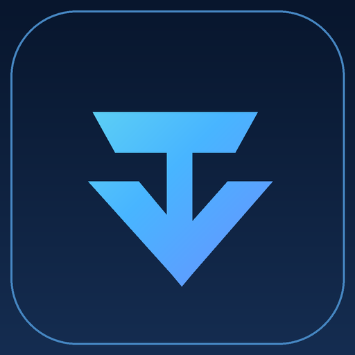

# TandemVector Labs — Organization Control and Community Standards

This repository powers the [TandemVector Labs organization profile](profile/README.md) under the **current GitHub namespace** `TandemVector-Labs`. The shared brand describes a jointly operated engineering and software R&D portfolio, **not a registered corporate identity**.

## Community standards

- [Organization profile](profile/README.md) — projects, GitHub forks, attribution and maturity
- [Public project directory](PROJECT_CATALOG.md) — source/fork provenance, official releases, issue routing and acceptance evidence
- [Shared development home](COLLABORATION_HOME.md) — two-owner collaboration, designated project issue/PR locations, and separate release authority
- [Fork synchronization control](FORK_SYNC_CONTROL.md) — exact source/fork commit audit, drift classification and non-force reconciliation gates
- [Governance](GOVERNANCE.md) — joint stewardship, evidence-based decisions and preservation of upstream authority
- [Security](SECURITY.md) — private vulnerability reporting and responsible disclosure
- [Contributing](CONTRIBUTING.md) — reproducible bug reports and PRs
- [Code of Conduct](CODE_OF_CONDUCT.md) — respectful technical collaboration
- [Support](SUPPORT.md) — project-specific help and upstream routing
- [Namespace migration](HANDLE_MIGRATION.md) — reviewed handle-change preflight, impacted links and rollback constraints
- [Open organization gates](https://github.com/TandemVector-Labs/.github/issues/1) — live checklist with evidence-backed acceptance status
- [Issue templates](.github/ISSUE_TEMPLATE/) and [PR template](.github/PULL_REQUEST_TEMPLATE.md)

GitHub inherits supported default community files from this public `.github` repository only when a target repository does not supply an overriding file. A policy written here is not proof that security settings, branch rules, or two-person approvals are enabled.

**Current URL:** https://github.com/TandemVector-Labs
**Handle rename:** Completed through GitHub organization Settings on 2026-10-20; canonical organization URL is https://github.com/TandemVector-Labs. Existing repository links may redirect, but the old organization page and REST API do not.

## Visual identity

The organization profile uses the original **owner-approved TandemVector Labs** artwork. The files below distinguish current profile graphics, earlier scalable artwork, conceptual project covers and genuine product screenshots:

- [Scalable brand mark](brand/monogram.svg) (SVG)
- [Current vector profile banner](brand/banner.svg) (SVG, 1600 × 520; used in the [organization profile](profile/README.md))
- [Preserved previously approved banner](brand/banner-approved-20261030.webp) (WebP, 1440 × 480; retained without changes)
- [Approved organization avatar](brand/avatar.png) (PNG, 512 × 512; rasterized from [the canonical SVG mark](brand/monogram.svg); matching GitHub organization account avatar was separately owner-uploaded and public-verified on 2026-10-30)

**Usage boundaries:** This original artwork represents a shared project and collaboration identity—not a registered company, cleared trademark, verified domain, completed product release, or third-party endorsement. The current namespace remains `TandemVector-Labs`; these assets do not rename the organization. Updating `brand/avatar.png` in this repository does **not** automatically update the GitHub account avatar. The approved version was separately uploaded in the organization owner's authenticated Settings on 2026-10-30 and independently checked on the public avatar CDN; any future change must be applied and verified there separately. Keep private repositories, secrets and unlicensed content out of the public profile.

## Featured project visuals

The [organization profile](profile/README.md) uses [Remote Commander Browser](brand/hero/RemoteCommanderBrowser-hero-20261030.png) and [ChatGPT Remote Commander](brand/hero/ChatGPTRemoteCommander-hero-20261030.png) as **conceptual illustrations**, not application screenshots or evidence of product readiness. Its [Open Internet Gateway](brand/screenshots/OpenInternetGateway-dashboard.png) and [FreeNet Hub R37](brand/screenshots/FreeNetHub-R37-dashboard.png) panels are **real, historical application screenshots**, not current-release acceptance evidence. These are distinct from the smaller social preview images below.

## Repository social preview artwork

Eight optional, original **1280 × 640 PNG** designs (each **under 1 MB**) coordinate with the organization banner. The **Remote Commander Browser** and **ChatGPT Remote Commander** Social Preview cards use full-color 1280 × 640 reductions of the owner-approved 1774 × 887 illustrated covers (Lanczos resampling; respectively 945,015 and 937,573 bytes); their full-resolution originals remain in [`brand/hero/`](brand/hero/). They are stored as reusable artwork, **not automatically applied as repository Social previews**. A repository administrator must select the appropriate PNG under the relevant repository's **Settings → Social preview → Edit → Upload an image** once the asset is published and independent account-setting access is available. Check the public link card afterward.

| Project | Preview | Intended destinations |
| --- | --- | --- |
| Remote Commander Browser | [PNG](brand/social/remote-commander-browser.png) | Organization original |
| ChatGPT Remote Commander | [PNG](brand/social/ChatGPTRemoteCommander.png) | Personal authoritative source and organization fork |
| Open Internet Gateway | [PNG](brand/social/OpenInternetGateway.png) | Personal authoritative source and organization fork |
| FreeNet Hub | [PNG](brand/social/FreeNetHub.png) | Personal authoritative source and organization fork |
| Direct Internet Method | [PNG](brand/social/DirectInternetMethod.png) | Personal authoritative source and organization fork |
| Taskbar Monitor Enhanced | [PNG](brand/social/TaskbarMonitorEnhanced.png) | Personal authoritative source and organization fork |
| Persian Word Agent | [PNG](brand/social/PersianWordAgent.png) | Personal authoritative source and organization fork |
| Appearance Studio Core | [PNG](brand/social/AppearanceStudio-Core.png) | Organization original |

**Boundaries:** These previews do not imply official affiliation, stable release status, ownership transfer, author approval, license changes or active maintenance. Legacy third-party forks, transfer staging and private repositories have no branded social preview in this pack. Preserve existing repo-specific imagery when it better represents the project and its upstream authorship.
