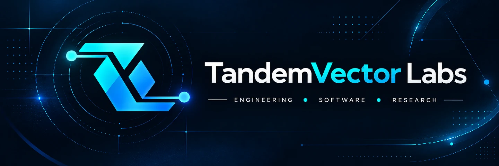
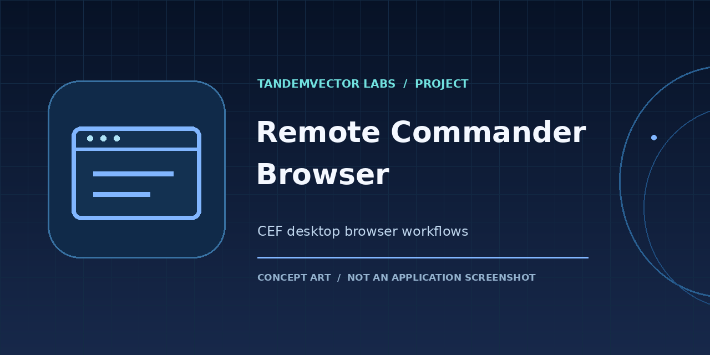
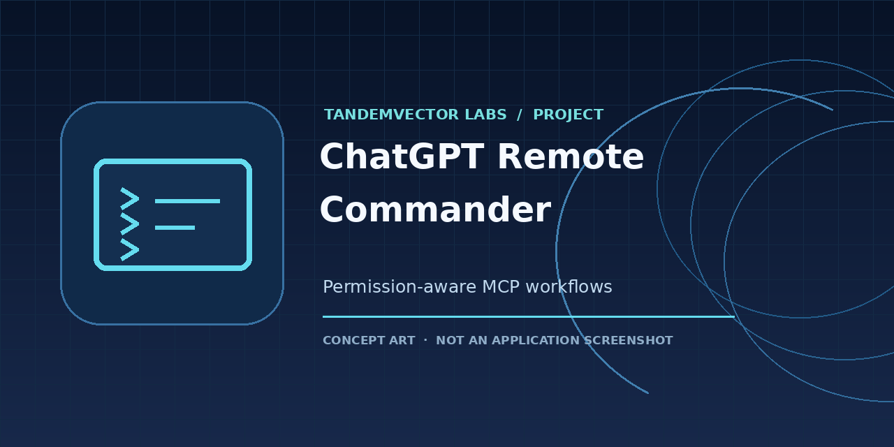
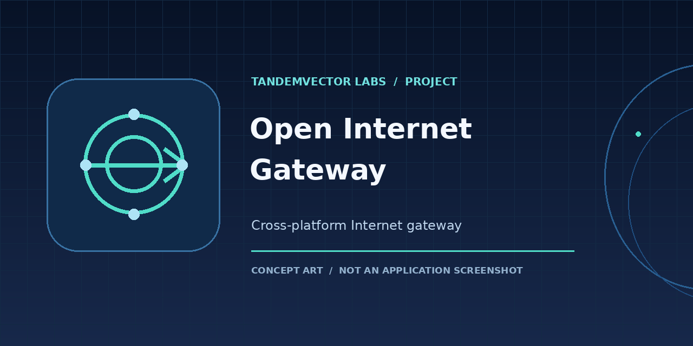
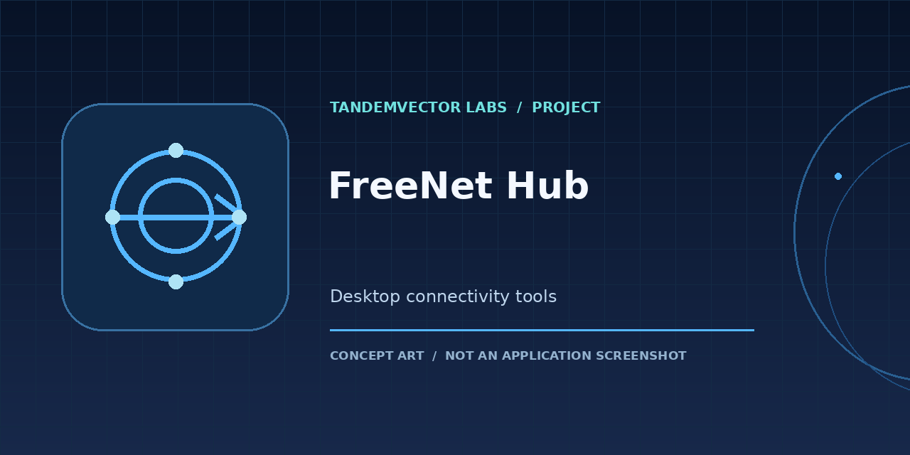

<!-- Public TandemVector Labs profile; no private projects or unreleased artwork. -->

  

  <a href="https://github.com/TandemVector-Labs/.github/blob/main/PROJECT_CATALOG.md"><strong>Project directory</strong></a> &nbsp;·&nbsp;
  <a href="https://github.com/TandemVector-Labs/.github/blob/main/CONTRIBUTING.md">Contribute</a> &nbsp;·&nbsp;
  <a href="https://github.com/TandemVector-Labs/.github/blob/main/GOVERNANCE.md">Governance</a> &nbsp;·&nbsp;
  <a href="https://github.com/TandemVector-Labs/.github/blob/main/SECURITY.md">Security</a> &nbsp;·&nbsp;
  <a href="https://github.com/TandemVector-Labs/.github/blob/main/SUPPORT.md">Support</a>

## About TandemVector Labs

**A shared engineering and software R&D collective — building reliable systems together.**

TandemVector Labs is a **jointly operated technical collective**, not the personal brand of either contributor. Our work connects developer tools, applied engineering, research workflows, secure desktop software, and connectivity systems. We prioritize **traceable changes, clear limitations, security-conscious design, and reproducible releases**.

> **Brand:** TandemVector Labs · **Current GitHub namespace:** `TandemVector-Labs`. The organization URL was aligned with its displayed brand on 2026-10-20. This is a project and collaboration identity, **not a claim of registered company status or trademark clearance**. Each repository has its own licensing and release maturity.

### Navigate the portfolio

| Discover | Build & contribute | Check provenance |
| :--- | :--- | :--- |
| **[Public project catalog](https://github.com/TandemVector-Labs/.github/blob/main/PROJECT_CATALOG.md)** Find each project and its intended audience. | **[Contribution guide](https://github.com/TandemVector-Labs/.github/blob/main/CONTRIBUTING.md)** Issues, pull requests and scoped review. | **[Governance](https://github.com/TandemVector-Labs/.github/blob/main/GOVERNANCE.md)** Who maintains what and how decisions are reviewed. |
| **[Featured work](#featured-public-projects)** Browse project visuals and introductions. | **[Support](https://github.com/TandemVector-Labs/.github/blob/main/SUPPORT.md)** Find the appropriate help channel. | **[Security policy](https://github.com/TandemVector-Labs/.github/blob/main/SECURITY.md)** Report sensitive issues privately. |

*An organization fork is a collaboration location, not automatically the original source or the official release channel.*

### Areas of work

| Developer tooling | Desktop experiences | Connectivity and research |
| :--- | :--- | :--- |
| Automation workflows, reproducible utilities and engineering infrastructure | Accessible interfaces, desktop software and practical user-focused tools | Reliable networking, technical experimentation and applied R&amp;D |

### Featured public projects

| | |
| :--- | :--- |
|  |  |
| **[Remote Commander Browser](https://github.com/TandemVector-Labs/remote-commander-browser)** — organization-origin project; candidate-stage software | **[ChatGPT Remote Commander](https://github.com/TandemVector-Labs/ChatGPTRemoteCommander)** — organization fork; [personal upstream and releases](https://github.com/GOD13emad/ChatGPTRemoteCommander) |
|  |  |
| **[Open Internet Gateway](https://github.com/TandemVector-Labs/OpenInternetGateway)** — organization fork; [personal upstream and releases](https://github.com/GOD13emad/OpenInternetGateway) | **[FreeNet Hub](https://github.com/TandemVector-Labs/FreeNetHub)** — organization fork; [personal upstream and releases](https://github.com/GOD13emad/FreeNetHub) |

*These visual cards are a navigation aid, not GitHub pinned-repository settings or an indication of release acceptance. See each project's README and the directory below for current status and attribution.*

## Explore the work

Browse the [complete public project directory](https://github.com/TandemVector-Labs/.github/blob/main/PROJECT_CATALOG.md) for verified upstream links, release locations, issue reporting and status boundaries.

### Original projects hosted in this organization

| Project | Focus | Status |
| --- | --- | --- |
| **[Remote Commander Browser](https://github.com/TandemVector-Labs/remote-commander-browser)** | Unofficial Chromium Embedded Framework (CEF) desktop browser shell, with native tabs, Persian/Arabic RTL support, and narrowly scoped permissions | **Candidate-stage**; refer to its own README and releases for verified details |
| **[Appearance Studio Core](https://github.com/TandemVector-Labs/AppearanceStudio-Core)** | Linux/GNOME appearance tooling, Theme Packs and transactional rollback; written by Dr. Emadoddin under the distinct **Arclenor Technologies** product identity | **v0.9.0 release candidate**, GNOME 50 live acceptance still pending; no shipped Windows version claimed |

Remote Commander Browser is a **separate project** from the Remote Commander MCP server. It is not an official OpenAI or ChatGPT desktop application.

### Public forks of contributor-owned projects

These are **GitHub forks inside this organization**. The personal repositories remain the **upstream sources**; they have not been transferred or deleted. Fork commit parity is a point-in-time property, not a guarantee of continuous synchronization; verify current refs before relying on a fork for release or integration work.

| Organization repository | Original upstream | Focus |
| --- | --- | --- |
| [ChatGPT Remote Commander](https://github.com/TandemVector-Labs/ChatGPTRemoteCommander) | [Source](https://github.com/GOD13emad/ChatGPTRemoteCommander) | Permission-aware Windows/Linux MCP and project workflows |
| [Direct Internet Method](https://github.com/TandemVector-Labs/DirectInternetMethod) | [Source](https://github.com/GOD13emad/DirectInternetMethod) | Windows/Linux direct-connect networking |
| [FreeNet Hub](https://github.com/TandemVector-Labs/FreeNetHub) | [Source](https://github.com/GOD13emad/FreeNetHub) | Desktop connectivity tools |
| [Open Internet Gateway](https://github.com/TandemVector-Labs/OpenInternetGateway) | [Source](https://github.com/GOD13emad/OpenInternetGateway) | Cross-platform, self-healing network gateway |
| [Taskbar Monitor Enhanced](https://github.com/TandemVector-Labs/TaskbarMonitorEnhanced) | [Source](https://github.com/GOD13emad/TaskbarMonitorEnhanced) | Windows taskbar and hardware monitoring |
| [Persian Word Agent](https://github.com/TandemVector-Labs/PersianWordAgent) | [Source](https://github.com/GOD13emad/PersianWordAgent) | Persian-language Microsoft Word assistance |

**Joint development routing:** New PRs and new issue reports for **all six original-contributor forks listed above** go to their shared organization repositories; see [Shared development home](https://github.com/TandemVector-Labs/.github/blob/main/COLLABORATION_HOME.md). Personal repositories remain the original GitHub fork parents and currently host existing releases and updater endpoints. Forks are not a full transfer of historic GitHub Issues, PRs, releases, Wikis, settings, or CI secrets; do not assume automatic syncing. Legacy third-party fork chains retain their original upstream routing.

### Legacy third-party fork lineage

These are older **forks of third-party upstream projects**, not products originally authored by this organization:

- [LTEMonitor in this organization](https://github.com/TandemVector-Labs/LTEMonitor) ← [personal fork](https://github.com/GOD13emad/LTEMonitor) ← [original upstream](https://github.com/kruzer/LTEMonitor)
- [WSAGAScript in this organization](https://github.com/TandemVector-Labs/WSAGAScript) ← [personal fork](https://github.com/GOD13emad/WSAGAScript) ← [original upstream](https://github.com/WSA-Community/WSAGAScript)

Their own licenses, credits, maturity, and upstream support policies remain authoritative. Presence in the organization does **not** imply active maintenance.

The complete public project list, including legacy work and forks, is available at [the contributor's GitHub profile](https://github.com/GOD13emad?tab=repositories). **Private repositories are intentionally not listed.**

## Joint stewardship

Two active GitHub organization owners jointly steward this portfolio. Neither account is the sole owner of the collective, and individual repositories retain their documented authorship, licensing and release authority.

| [ **Aliakbar Emadoddin**](https://github.com/GOD13emad) | [ **MMZ**](https://github.com/mohammadmohammadzadeh19960-code) |
| :---: | :---: |
| Mechanical engineering research, developer tooling and original-source stewardship | Mechanical engineering research & development and joint organization stewardship |

Both owners share administration within the organization, but this does **not** grant shared ownership of personal upstream repositories. Governance and contribution standards are available in [Governance](https://github.com/TandemVector-Labs/.github/blob/main/GOVERNANCE.md), [Security](https://github.com/TandemVector-Labs/.github/blob/main/SECURITY.md), and [Contributing](https://github.com/TandemVector-Labs/.github/blob/main/CONTRIBUTING.md).

## How we work

- **Evidence before claims:** build success, runtime verification, user acceptance, and release qualification are distinct gates.
- **Security and privacy:** never include access tokens, credentials, browser sessions, private datasets, or personal information in issues or commits.
- **Reproducibility:** document dependencies, supported platforms, commands, checks, and known limitations.
- **Preserve provenance:** retain commit history, original authorship, licensing, and upstream credits when projects are imported or mirrored.
- **Scoped ownership:** changes, feature requests, bugs, and security reports belong in the relevant project repository.

## Contributing and reporting issues

1. Select the relevant repository and read its `README`, contribution guidelines, and license/notice files.
2. For a bug, provide the exact version, operating system, steps to reproduce, expected behavior, actual behavior, and sanitized logs.
3. For security-sensitive findings, follow that repository's `SECURITY.md` instructions. **Do not publish exploit details or secrets in public issues.**
4. Submit targeted pull requests with test evidence and a rollback path for changes that affect existing behavior.

**No organization-wide release or compatibility guarantee is implied.** Review the current status of each repository before installing or deploying it.

## فارسی

این مجموعه برای معرفی و توسعه ابزارهای مهندسی، نرم‌افزارهای کاربردی و گردش‌کارهای فنیِ قابل بازتولید ایجاد شده است. هر پروژه مستندات، سطح بلوغ، شرایط مجوز و الزامات امنیتی مخصوص خود را دارد.

هشت پروژه عمومی در قالب **Fork** به سازمان اضافه شده‌اند. **توسعه مشترک و ثبت مشکل جدید شش پروژهٔ اصلی در مخازن سازمانی انجام می‌شود**؛ مخازن شخصی آن‌ها فعلاً محل انتشار نسخه‌های رسمی و لینک‌های به‌روزرسانی هستند. Forkهای شخص ثالث طبق راهنمای منبع اصلی مدیریت می‌شوند و همگام‌سازی خودکار همه سرویس‌های GitHub تضمین نشده است. **مخازن خصوصی بدون بررسی مجوز و سطح دسترسی منتشر نمی‌شوند.**

## Independence and trademarks

Projects here are independent unless a specific repository expressly states otherwise. References to ChatGPT, OpenAI, CEF, Windows, or other products identify technologies or compatibility targets; they do **not** imply endorsement, partnership, or official status. Third-party trademarks and licenses belong to their respective owners.
